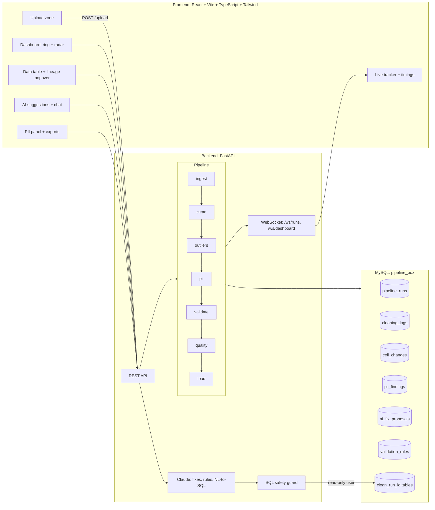

# Data Pipeline in a Box

> **Turn a messy file into trusted, explainable, queryable data in seconds, where every change is visible, reversible, and reproducible.**


<!-- Replace with a screen recording / GIF of your demo -->


---

## Table of Contents

1. [What is this?](#what-is-this)
2. [Why "in a Box"?](#why-in-a-box)
3. [Why general data, not one topic?](#why-general-data-not-one-topic)
4. [Features](#features)
5. [Architecture](#architecture)
6. [How the pipeline works](#how-the-pipeline-works)
7. [Quality score](#quality-score)
8. [Tech stack](#tech-stack)
9. [Project structure](#project-structure)
10. [Getting started](#getting-started)
11. [Configuration](#configuration)
12. [Using the app](#using-the-app)
13. [API reference](#api-reference)
14. [Database schema](#database-schema)
15. [Security design](#security-design)
16. [Performance](#performance)
17. [Testing](#testing)
18. [3-minute demo script](#3-minute-demo-script)
19. [Roadmap](#roadmap)
20. [Troubleshooting](#troubleshooting)
21. [Author](#author)

---

## What is this?

Data teams spend most of their time **cleaning** data, not analyzing it. Worse, most cleaning tools are black boxes: you cannot tell what they changed, why they changed it, or how to undo it.

**Data Pipeline in a Box** is a complete, real-time data pipeline in one application. Upload a messy CSV or Excel file and watch it move through five live stages (ingest, clean, validate, score, store). It ends up as a clean table in MySQL with a quality score and a full audit trail.

Then you can:

- Click any cell to see **exactly what changed and why**, and **revert** it.
- Ask questions about your data **in plain English** and get SQL results.
- Review **AI-proposed fixes** and approve or reject each one.
- **Detect and mask personal data** before sharing.
- **Export the pipeline as a Python or SQL script** so the work is reproducible.

---

## Why "in a Box"?

A data pipeline is the chain of steps that turns raw data into clean, usable data. Normally that requires many separate tools (a file reader, a cleaning script, a database, a quality checker, a dashboard, a security layer) and an expert to connect them.

**"In a Box" means the whole pipeline is packed into one ready-to-use application.** You upload a file and everything else is included, with no setup beyond running the app.

```
Normally:  reader + cleaner + database + quality checker + dashboard + security
           (7 things, wired together by an expert)

In a Box:  upload a file  ->  clean, trusted, queryable data
```

---

## Why general data, not one topic?

A weather app, a hospital system, and a sales dashboard all depend on **clean data first**. A topic-specific app helps one domain. This project is the layer *underneath* every domain, so it works the same on weather readings, student marks, sales records, or sensor logs.

| Topic-specific app | Data Pipeline in a Box |
|---|---|
| Useful for one type of data | Works on any tabular data |
| Consumes data | Prepares data for every consumer |
| Cleaning is hidden or assumed | Cleaning is the product, and it is auditable |

A sample messy weather file is included (`backend/samples/messy_weather_data.csv`) to show it working on a concrete domain.

---

## Features

### Core pipeline
- **Live, streamed processing**: five stages pushed to the UI over WebSockets
- **Real cleaning logic**: drop empties, snake_case columns, dedupe, impute nulls (median for numbers, mode for text), coerce dates and numbers
- **Validation rules**: `not_null`, `min`, `max`, `range`, `regex`, managed from the UI
- **Quality scoring**: four dimensions, computed before and after cleaning
- **Real MySQL storage**: every run produces its own `clean_<run_id>` table
- **Run history and dashboard stats** that update live with no refresh
- **Exports**: cleaned CSV and a quality report

### Trust and explainability
- **Cell-level lineage**: original value, new value, rule applied, and timestamp for every change
- **One-click revert** that recomputes the quality score
- **Outlier detection (IQR)**: values are **flagged, never silently changed**
- **Quality radar chart**: completeness, uniqueness, validity, consistency (before vs after)

### AI (Claude)
- **Natural-language questions**: plain English to SQL to results table and chart
- **AI-proposed fixes with human approval**: each proposal shows a projected score gain; the backend applies only whitelisted operations
- **AI-suggested validation rules**, added with one click
- Graceful fallback to heuristic suggestions if no API key is set

### Privacy and security
- **PII detection**: emails, phone numbers, national-ID-like patterns
- **Masked export** (e.g. `j***@gmail.com`)
- **Read-only database user** for AI queries plus a SELECT-only SQL guard
- **Secrets only in `backend/.env`**, never exposed to the frontend

### Reproducibility and operations
- **Export pipeline as code**: standalone Python (pandas only) or SQL
- **Re-run** a past run on its stored original file
- **Quality threshold alerts**: toast and banner when a run scores below the threshold
- **Throughput metrics**: per-stage timings and rows/sec, tested on 100,000 rows

---

## Architecture



### Request flow

```
Upload ──► run created (queued) ──► background task starts
   │
   ├─► ingest   ──► WebSocket event ──► tracker updates
   ├─► clean    ──► cell_changes written (lineage) ──► log lines stream
   ├─► validate ──► rule violations recorded
   ├─► score    ──► 4-dimension quality (before & after)
   └─► store    ──► clean_<run_id> table ──► /ws/dashboard broadcast
```

---

## How the pipeline works

| Stage | What it does | Output |
|---|---|---|
| **Ingest** | Reads CSV/Excel with pandas and profiles rows, columns, dtypes | Raw DataFrame, schema profile |
| **Clean** | Drops empty rows and columns, snake_cases names, removes duplicates, imputes nulls, coerces types, tracks every change (vectorized) | Cleaned DataFrame, `cell_changes` rows |
| **Outliers** | IQR: flags values outside `Q1 - 1.5*IQR` to `Q3 + 1.5*IQR` | Flags only, values untouched |
| **PII** | Column-level regex match rate plus name hints | `pii_findings` rows |
| **Validate** | Applies active rules from `validation_rules` | Violations per rule |
| **Score** | Four-dimension quality, before and after | Scores on the run |
| **Store** | Bulk-loads into MySQL (chunked) and registers the table | `clean_<run_id>` |

Every stage reports `duration_ms` and `rows_per_sec` in its WebSocket event.

---

## Quality score

The 0 to 100 score is the weighted sum of four dimensions, each computed before and after cleaning:

```
Quality = 30% Completeness   share of non-missing values
        + 25% Uniqueness     share of non-duplicate rows
        + 25% Validity       share of values passing validation rules
        + 20% Consistency    per column, share of values matching the dominant format
```

The radar chart overlays **before** (gray) and **after** (teal) so you can see which dimension improved and why.

---

## Tech stack

| Layer | Technology |
|---|---|
| Frontend | React, TypeScript, Vite, Tailwind CSS, shadcn/ui, Recharts (AMOLED black theme) |
| Backend | Python 3.11, FastAPI, SQLAlchemy, PyMySQL, pandas |
| Database | MySQL 8.0 |
| Real-time | WebSockets (per-run stages and dashboard stats) |
| AI | Anthropic Claude (fix proposals, rule suggestions, NL-to-SQL) |
| Testing | pytest, a full end-to-end verification script |

---

## Project structure

```
data-pipeline-in-a-box/
├── backend/
│   ├── main.py                 # FastAPI app, REST + WebSocket endpoints
│   ├── database.py             # DB engine (URL-encodes special chars in passwords)
│   ├── models.py               # SQLAlchemy models
│   ├── ai.py                   # Claude integration + SQL safety guard
│   ├── seed.py                 # Loads 3 sample completed runs
│   ├── verify_all.py           # End-to-end verification suite
│   ├── pipeline/
│   │   ├── ingest.py
│   │   ├── clean.py
│   │   ├── outliers.py
│   │   ├── pii.py
│   │   ├── validate.py
│   │   ├── quality.py
│   │   └── load.py
│   ├── scripts/
│   │   └── create_readonly_user.py
│   ├── samples/
│   │   ├── messy_customers_sample.csv
│   │   ├── messy_weather_data.csv
│   │   ├── corrupt_sample.csv
│   │   └── generate_large_sample.py
│   ├── tests/
│   ├── .env.example
│   └── requirements.txt
├── src/                        # React frontend
│   ├── components/             # Dashboard, DataTable, ChatWidget, Processing, ValidationRulesPanel, ...
│   ├── hooks/use-websocket.ts  # Auto-reconnecting WebSocket hook
│   ├── lib/api.ts              # API client
│   └── routes/
├── .github/workflows/ci.yml
├── start.bat                   # One-command launcher (Windows)
├── start.sh                    # One-command launcher (Linux/macOS)
└── README.md
```

---

## Getting started

### Prerequisites

- **Python 3.11+**
- **Node.js 18+** and npm
- **MySQL 8.0** installed and running
- *(Optional)* An **Anthropic API key** for live AI features

### 1. Clone

```bash
git clone https://github.com/<your-username>/data-pipeline-in-a-box.git
cd data-pipeline-in-a-box
```

### 2. Configure secrets

```bash
cp backend/.env.example backend/.env
```

Open `backend/.env` and fill in your values (see [Configuration](#configuration)). **Never commit this file.**

### 3. Install dependencies

```bash
# Backend
cd backend
python -m venv .venv
# Windows: .venv\Scripts\activate    |    macOS/Linux: source .venv/bin/activate
pip install -r requirements.txt
cd ..

# Frontend
npm install
```

### 4. Create the database

The backend creates tables automatically on startup. Create the database once:

```sql
CREATE DATABASE IF NOT EXISTS pipeline_box
  CHARACTER SET utf8mb4 COLLATE utf8mb4_unicode_ci;
```

### 5. (Recommended) Create the read-only AI user

Set `DB_RO_USER` and `DB_RO_PASSWORD` in `backend/.env`, then run:

```bash
python backend/scripts/create_readonly_user.py
```

### 6. Seed demo data (optional)

```bash
python backend/seed.py
```

### 7. Run everything

**One command:**

```bash
# Windows
start.bat

# macOS / Linux
./start.sh
```

**Or manually, in two terminals:**

```bash
# Terminal 1: backend  ->  http://localhost:8000  (docs at /docs)
cd backend
uvicorn main:app --reload --port 8000

# Terminal 2: frontend  ->  http://localhost:8080
npm run dev
```

---

## Configuration

All backend secrets live in `backend/.env` only. They are never sent to the frontend and never logged.

| Variable | Description | Example |
|---|---|---|
| `DB_HOST` | MySQL host | `localhost` |
| `DB_PORT` | MySQL port | `3306` |
| `DB_USER` | MySQL user | `root` |
| `DB_PASSWORD` | MySQL password | *(your password)* |
| `DB_NAME` | Database name | `pipeline_box` |
| `DB_RO_USER` | Read-only user for AI queries | `pipeline_ro` |
| `DB_RO_PASSWORD` | Read-only user password | *(choose one)* |
| `ANTHROPIC_API_KEY` | Enables live AI features | `sk-ant-...` |

Frontend (`.env`):

| Variable | Description | Default |
|---|---|---|
| `VITE_API_URL` | Backend base URL | `http://localhost:8000` |

> If `ANTHROPIC_API_KEY` is missing or still a placeholder, the app still works. Only live AI features fall back to deterministic heuristic suggestions, and the chat shows a friendly "AI unavailable" message.

---

## Using the app

1. **Upload** a CSV or Excel file (try `backend/samples/messy_weather_data.csv`).
2. **Watch** the five stages stream live, with per-stage timings and rows/sec.
3. **Read the score**: the quality ring and the before/after radar chart.
4. **Inspect the table**: modified cells carry badges. Click one to open the **lineage popover** (original, new, rule, time) and **revert** if you disagree.
5. **Check outliers**: amber badges show the bound that was broken. Use the *Outliers only* filter.
6. **Review PII**: see detected columns and export a **masked** CSV.
7. **AI suggestions**: approve or reject proposed fixes and see the real score change. Add AI-suggested validation rules in one click.
8. **Ask questions** in the chat widget, e.g. *"Which city has the highest average temperature?"*
9. **Add validation rules**, e.g. `humidity_pct` range 0 to 100, then re-run to see violations.
10. **Export**: cleaned CSV, quality report, or the whole pipeline as Python or SQL.

### Sample file: what's messy about it

`backend/samples/messy_weather_data.csv` (131 rows) includes duplicate rows, blank rows, missing values, `N/A` strings, four date formats, inconsistent city names (`Hyd`, `HYDERABAD`, `Bombay`, `Bangalore`), units embedded in numbers (`25.4°C`), impossible values (`900` °C, humidity `240`), outliers, and a PII column (`contact_email`).

Suggested validation rules for the demo:

| Column | Rule |
|---|---|
| `humidity_pct` | range 0 to 100 |
| `temperature_c` | range -20 to 55 |
| `rainfall_mm` | range 0 to 500 |

---

## API reference

Interactive docs: **http://localhost:8000/docs**

### Health and stats

| Method | Endpoint | Description |
|---|---|---|
| GET | `/health` | Confirms the API and DB connection |
| GET | `/stats` | Aggregate stats (total runs, avg quality, rows cleaned) |

### Runs

| Method | Endpoint | Description |
|---|---|---|
| POST | `/upload` | Upload CSV/Excel, create a run, process in the background |
| GET | `/runs` | List runs |
| GET | `/runs/{id}` | Run details, scores, stage timings |
| GET | `/runs/{id}/logs` | Cleaning log lines |
| GET | `/runs/{id}/data` | Cleaned rows (paginated, sortable, filterable, with modified-cell info) |
| GET | `/runs/{id}/columns` | Per-column profile: missing values, dtypes, outliers, before/after counts |
| POST | `/runs/{id}/rerun` | Re-run on the stored original file |

### Lineage and trust

| Method | Endpoint | Description |
|---|---|---|
| GET | `/runs/{id}/cells/{row}/{column}/lineage` | Full change history for a cell |
| POST | `/runs/{id}/cells/revert` | Restore a cell's original value and recompute scores |
| GET | `/runs/{id}/pii` | PII findings |

### AI

| Method | Endpoint | Description |
|---|---|---|
| POST | `/runs/{id}/suggestions` | AI-proposed fixes with projected score change |
| POST | `/runs/{id}/fixes/{fix_id}/approve` | Apply a proposed fix |
| POST | `/runs/{id}/fixes/{fix_id}/reject` | Reject a proposed fix |
| POST | `/runs/{id}/suggest-rules` | AI-suggested validation rules |
| POST | `/runs/{id}/ask` | Natural language to SQL to results |

### Validation rules and settings

| Method | Endpoint | Description |
|---|---|---|
| GET / POST | `/validation-rules` | List or create rules |
| PUT / DELETE | `/validation-rules/{id}` | Update or delete a rule |
| GET / PUT | `/settings/quality-threshold` | Read or set the alert threshold |

### Exports

| Method | Endpoint | Description |
|---|---|---|
| GET | `/runs/{id}/export/data` | Cleaned CSV (`?masked=true` masks PII) |
| GET | `/runs/{id}/export/report` | Quality report |
| GET | `/runs/{id}/export/pipeline?format=python\|sql` | Reproducible pipeline script |

### WebSockets

| Endpoint | Pushes |
|---|---|
| `/ws/runs/{run_id}` | `{stage, status, message, progress_percent, timestamp, duration_ms, rows_processed, rows_per_sec}` |
| `/ws/dashboard` | Aggregate stats and quality-threshold alerts when any run completes |

---

## Database schema

| Table | Purpose |
|---|---|
| `pipeline_runs` | One row per run: status, row counts, duplicates removed, nulls fixed, quality scores (total and per dimension), stage timings, rows/sec, `parent_run_id` |
| `cleaning_logs` | Step-by-step log lines per run |
| `cell_changes` | Cell-level lineage: row, column, original value, new value, change type (`imputed`, `coerced`, `standardized`, `outlier`, `pii_masked`), rule applied, reverted flag |
| `cleaned_data_registry` | Maps each run to its `clean_<run_id>` table |
| `validation_rules` | Rules: `not_null`, `min`, `max`, `range`, `regex` |
| `pii_findings` | Detected PII columns, type, and match percent |
| `ai_fix_proposals` | AI proposals with status (`proposed`, `approved`, `rejected`, `applied`), projected and actual score change |
| `settings` | App settings such as the quality threshold |
| `clean_<run_id>` | The cleaned dataset for each run |

---

## Security design

```
User question ─► Claude writes SQL ─► SQL guard ─► Read-only DB user ─► Result
                                        │
              blocks: INSERT, UPDATE, DELETE, DROP, ALTER, TRUNCATE,
                      other tables, missing LIMIT
```

- **Two layers on `/ask`**: a SELECT-only, single-table SQL validator **and** a MySQL user that physically has only `SELECT` privileges.
- **The AI never executes code.** For fixes, Claude *proposes* from a fixed menu (`normalize_phone`, `normalize_date_format`, `trim_whitespace`, `title_case`, `lowercase_email`, `map_category_synonyms`). The backend applies them through fixed code paths.
- **Human in the loop**: fixes need explicit approval, and every applied fix is logged and revertible.
- **Parameterized queries** everywhere, with column names whitelisted against the real table.
- **Upload validation**: file type and size limits; corrupt files end in a clean `failed` state with a readable error.
- **Secrets** live only in `backend/.env` (gitignored) and are never printed or sent to the browser.
- **Privacy**: only column names and small samples are sent to the AI, and PII can be masked on export.

---

## Performance

Fill these in with your **measured** numbers before publishing.

| Dataset | Rows | Total time | Rows/sec |
|---|---|---|---|
| Sample (customers) | 20 | [REPLACE] | [REPLACE] |
| Weather sample | 131 | [REPLACE] | [REPLACE] |
| Large synthetic file | 100,000 | [REPLACE] | [REPLACE] |

Design choices that keep it fast:

- Vectorized pandas change tracking (no per-cell Python loops)
- Cell diffs stored in an indexed `cell_changes` table instead of a giant JSON column
- Chunked bulk inserts (`chunksize=5000`, `method="multi"`)
- WebSocket progress events throttled to about 10 per second

Generate the large test file with:

```bash
python backend/samples/generate_large_sample.py
```

---

## Testing

```bash
# Unit and integration tests
cd backend
pytest

# Full end-to-end verification (needs the API + MySQL running)
python verify_all.py
```

The test suite covers vectorized change tracking, the four-dimension quality score, outlier detection, PII masking, lineage revert, the SQL safety guard (including prompt-injection attempts), and a full pipeline integration test. CI (`.github/workflows/ci.yml`) runs pytest and the frontend build on every push.

---

## 3-minute demo script

1. **Upload** `messy_weather_data.csv`. Point out the duplicates, 900 °C reading, and mixed formats.
2. **Watch** the live stages and the timings strip (rows/sec).
3. **Show** the quality ring and the radar chart (before vs after).
4. **Click a cell** to see lineage, then **Revert** it and watch the score update.
5. **Show** an amber outlier badge ("flagged, not changed").
6. **Open** the PII panel and export a masked CSV.
7. **Approve** one AI fix and **reject** another.
8. **Ask** *"Which city has the highest average temperature?"* in plain English.
9. *(Optional)* Try a prompt-injection attack and show it blocked.
10. **Export as Python** and show the reproducible script.

---

## Roadmap

- [ ] Scheduled runs on a URL or Google Sheet with Slack/email alerts
- [ ] Schema drift detection and run-to-run comparison
- [ ] Queue and workers for distributed processing of very large files
- [ ] User accounts and per-user workspaces
- [ ] Pluggable cleaning steps and custom fix types
- [ ] Support for more sources (Parquet, JSON, databases)

---

## Troubleshooting

| Problem | Fix |
|---|---|
| `Can't connect to MySQL` | Make sure MySQL is running and `DB_HOST`, `DB_PORT`, `DB_USER`, `DB_PASSWORD` in `backend/.env` are correct. |
| Password contains `@` or other special characters | Supported, since the backend URL-encodes it. Re-check for typos. |
| `Unknown database 'pipeline_box'` | Run the `CREATE DATABASE` statement in [step 4](#4-create-the-database). |
| AI chat says "AI unavailable" | Set a real `ANTHROPIC_API_KEY` in `backend/.env` and restart the backend. |
| Frontend can't reach the API | Check `VITE_API_URL` and that the backend is running on port 8000. |
| `/ask` fails with a permissions error | Run `create_readonly_user.py` and set `DB_RO_USER` / `DB_RO_PASSWORD`. |
| WebSocket drops | The client auto-reconnects. Check that the backend is still running. |

---

## Author

**Sathwik**: BTech CSE student, web developer and builder, Hyderabad.

Built for the FDE hackathon. Feedback and contributions are welcome. Open an issue or pull request.

---

> **Data Pipeline in a Box doesn't just clean your data. It earns your trust.**
